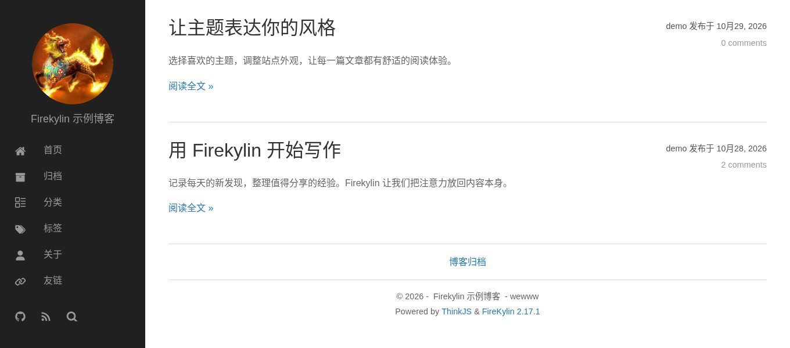
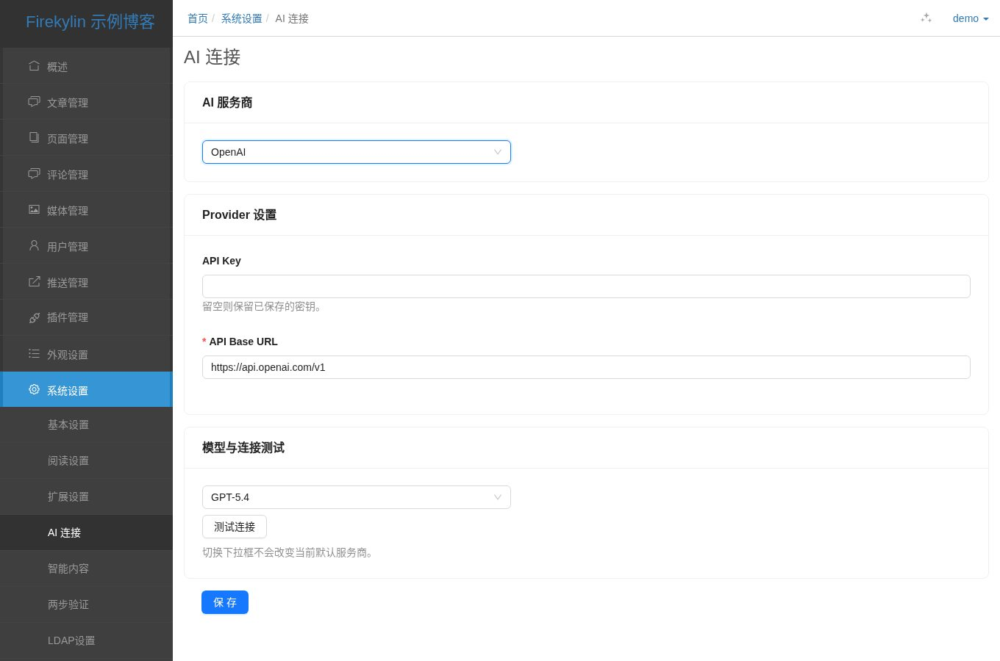
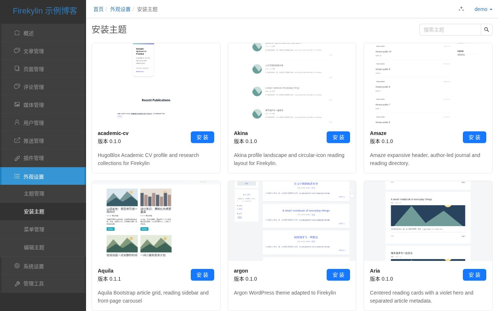
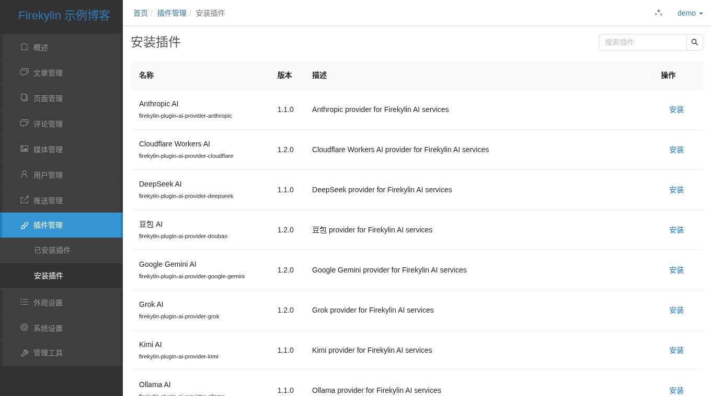
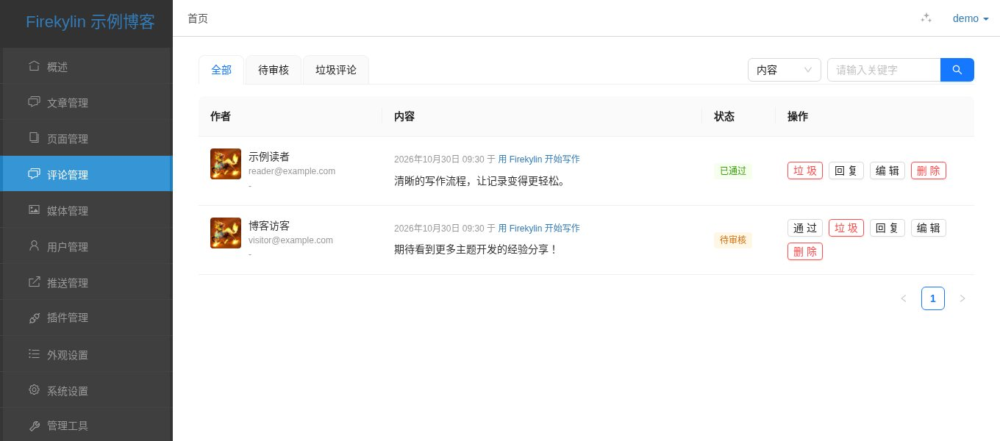
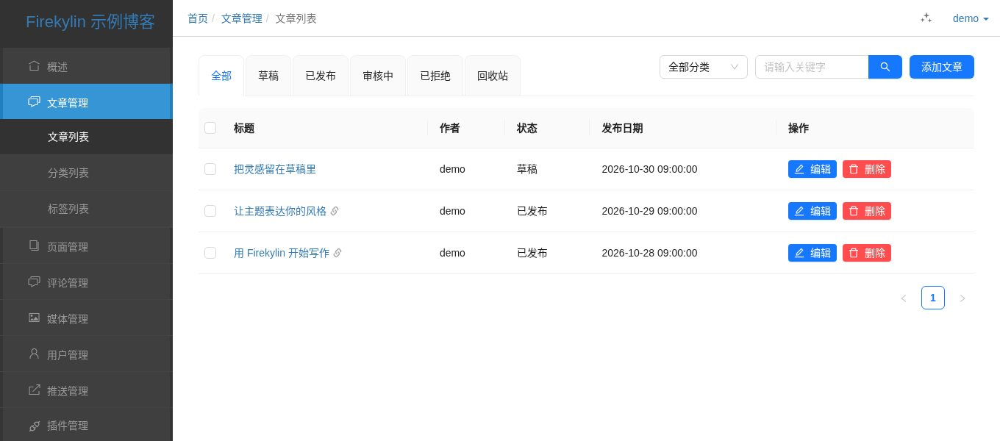

<div align="center">
  <a href="https://github.com/firekylin/Firekylin">
    <!--  -->
    
  </a>  

  <h1>Firekylin</h1>

  <div>
    <a href="https://github.com/firekylin/firekylin">
      
    </a>
    <a href="https://github.com/firekylin/firekylin/releases">
      
    </a>
    <a href="https://github.com/firekylin/firekylin/releases">
      
    </a>
  </div>
  <div>
    <a href="https://github.com/firekylin/firekylin/issues?q=is%3Aissue+is%3Aclosed">
      
    </a>
    <a href="https://github.com/firekylin/firekylin/blob/master/LICENSE">
      
    </a>
  </div>

  <p>AI friendly Node.js blog platform.</p>
</div>

## 概览

Firekylin（火麒麟）是一个开源免费的 Node.js 博客系统。通过浏览器管理文章、页面和评论，使用主题和插件扩展站点，支持 AI 辅助创作及 MCP 博客管理。



默认主题的博客首页。以下截图均来自真实运行的本地实例，使用示例内容。

## 特性

### AI 创作与管理

- **内容生成**：生成标题、摘要和封面，审校、翻译文章，提供分类标签建议、文章链接生成和写作补全。
- **图片生成**：通过文字生成配图，并继续调整图片；需要支持图片能力的服务商和模型。
- **MCP 管理**：连接支持远程 MCP 和 OAuth 的 AI 客户端，通过对话查找文章、管理草稿、分类标签和评论。操作遵循账号权限，发布、删除等操作需要确认。
- **服务商配置**：在后台选择 AI 服务商和模型；AI 调用费用按服务商规则计算。



AI 服务商与模型配置示例；未填写密钥，未调用生成服务。

### 主题市场

在后台搜索、预览、安装和更新主题，切换博客外观并调整主题配置。[查看官方主题](https://github.com/firekylin/themes)。



浏览官方主题，查看预览与版本信息。

### 插件市场

在后台搜索、安装和更新插件，管理启用状态与配置，包括 AI 服务商等扩展。[查看官方插件](https://github.com/firekylin/plugins)。



从官方插件目录查找并安装扩展。

### 评论管理

内置 Waline 评论，无需另建评论服务。支持评论回复与审核、社交账号登录、邮件通知，以及 Turnstile、reCAPTCHA 验证码。



集中查看、回复和审核评论。

### 内容管理

使用 Markdown 写作，管理文章、草稿、独立页面、分类、标签和上传文件，支持从其他博客系统导入内容。



按发布状态管理文章和草稿。

### Vercel 部署

支持本地、服务器和 Vercel 部署，可使用 SQLite、MySQL、TiDB 或 PostgreSQL。Vercel 需使用外部数据库，持久保存上传文件需配置对象存储。[查看部署指南](https://github.com/firekylin/firekylin/wiki/快速部署)。

主题和插件在本地安装后按提示启用或重启；GitHub 管理模式通过 PR 合并和重新部署生效。

## 安装

需要 Node.js 24+，或 Node.js 22.13.0 及以上的 22.x 版本。

```sh
npx firekylin new my-blog
cd my-blog
npm start
```

按提示选择数据库、填写站点信息并创建管理员账号。本地体验可选 SQLite，无需单独安装数据库服务。

保留默认地址时，打开 [博客首页](http://127.0.0.1:8360) 或 [管理后台](http://127.0.0.1:8360/admin)，使用创建的管理员账号登录。

## 如何使用

- [文章管理](https://github.com/firekylin/firekylin/wiki/文章) · [页面管理](https://github.com/firekylin/firekylin/wiki/页面) · [主题配置](https://github.com/firekylin/firekylin/wiki/主题外观) · [系统设置](https://github.com/firekylin/firekylin/wiki/系统设置)
- [连接 AI 助手（MCP）](https://github.com/firekylin/firekylin/blob/master/docs/mcp.md)
- [安装 Firekylin Agent Skill](https://github.com/firekylin/firekylin/blob/master/skills/firekylin/README.md)
- [AI 服务配置与内容辅助](https://github.com/firekylin/firekylin/blob/master/docs/ai-providers.md)

## 文档

[完整文档（Wiki）](https://github.com/firekylin/firekylin/wiki) · [使用交流](https://github.com/firekylin/firekylin/discussions) · [问题反馈](https://github.com/firekylin/firekylin/issues)

- [安装、配置与升级](docs/installation.md)
- [Widget 与主题模板扩展](docs/widgets.md) · [主题文章字段](docs/theme-fields.md) · [插件开发](docs/plugins.md)
- [评论、验证码与邮件通知](docs/comments.md) · [后台 JWT 认证与迁移](docs/admin-jwt.md)

## 捐赠支持

你的每一份帮助都将使 Firekylin 做的更好，走的更远！我们一直在坚持不懈地努力，并坚持让 Firekylin 完全开源免费，你的帮助将使我们更有动力和信心！

欢迎使用支付宝或者微信扫描二维码进行捐赠！已捐赠用户将在 [捐赠列表](https://github.com/firekylin/firekylin/wiki/捐赠列表) 中列出。

<div class="donate-qrcode">
 
</div>
